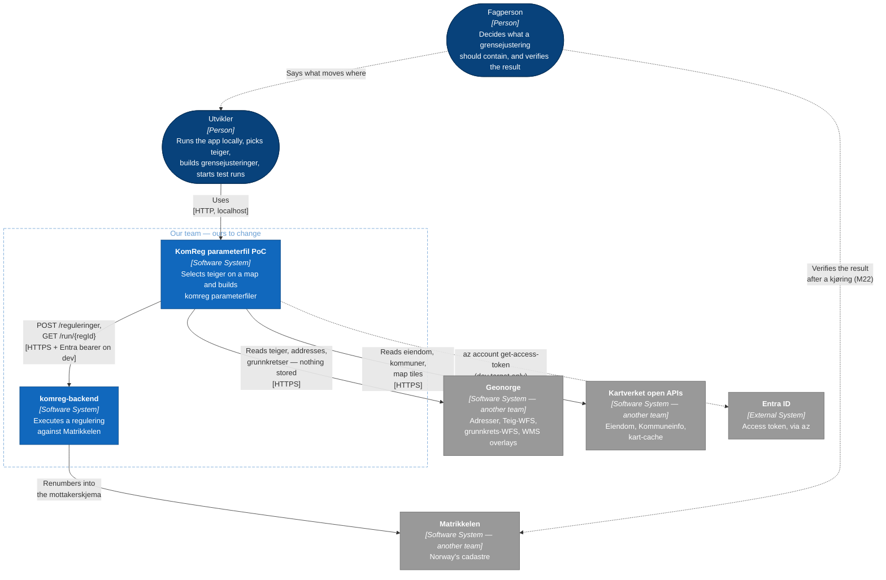
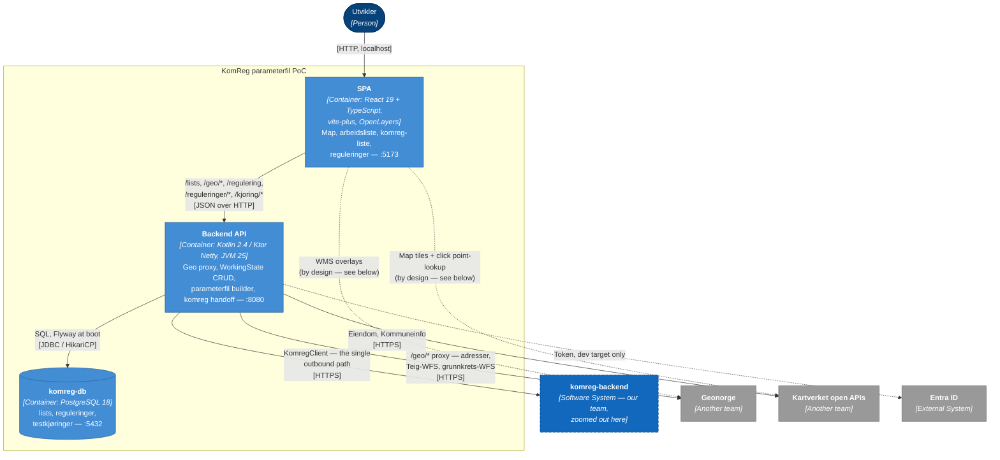

# Architecture — KomReg parameterfil PoC

One picture of the whole thing, at the two levels of the [C4 model](https://c4model.com/) that pay
for themselves here: **system context** (who we talk to) and **containers** (what runs, and the
rules at the boundaries between them).

What is *not* here, on purpose:

- **Level 3, components.** `backend/AGENTS.md` lists the Ktor slices (`lists/`, `geo/`,
  `regulering/`, `reguleringer/`, `kjoring/`) and `frontend/AGENTS.md` the frontend conventions.
  Both stay closer to the code than a diagram can.
- **The reasoning.** `docs/adr/` has the individual decisions. This file describes *what is*, and points at the ADR when a shape looks odd.
- **komreg-backend's internals.** Ours, but a black box at this level. Its own diagrams live in
  its own repo.

---

## Level 1 — System context

What to notice:

- **A developer drives the tool; a fagperson supplies the domain and checks the outcome.** Running
  this means docker compose on a laptop, `az login`, group membership and the Kartverket network —
  it is a technical setup, so the person at the keyboard is a developer. The fagperson decides what
  a grensejustering should contain, and after a test run verifies the result in Matrikkelen's
  mottakerskjema (M22) — never through this app, which has no view of what a kjøring did.
- **KomReg parameterfil PoC never writes to Matrikkelen.** It produces a parameterfil and hands it to
  komreg-backend, which does. The irreversible step is `GET /run/{regId}` over there — fire-and-forget
  against Matrikkelen, which is why Start kjøring asks first.
- **The dashed box is the team, not a system.** Kartverket owns Matrikkelen, Geonorge and the open
  APIs too, so "internal" at company scope separates nothing. Drawn at *team* scope it does: inside
  the box is what we can change — KomReg parameterfil PoC and komreg-backend. Grey outside is what we take as
  given, on someone else's schedule.
- **komreg-backend is ours and still a system of its own.** Own repo, own deploy on SKIP, own
  release cycle. Being on one team does not make two systems
  one: the seam this architecture is built around is that we build a payload and *hand it over*, and
  something else executes it. Level 2 zooms into KomReg parameterfil PoC alone for the same reason.
- **komreg-backend writes to Matrikkelen's mottakerskjema; this tool never does.** The
  mottakerskjema is not the live register. How komreg-backend gets there is described in its own
  repo. From here it means nothing on our side can preview, verify or undo what a kjøring did.
- **Nothing from Geonorge/Kartverket is stored.** Every lookup is read fresh. What we produce is a
  real matrikkel regulering, and a teig split or a new address from the last few weeks served from a
  cache would land in it.
- **No inbound auth at all.** `/lists` is global CRUD and the ids are sequential `SERIAL`. Fine while
  this runs on localhost; a shared host means adding auth first, not later.
- **Outbound auth follows `KOMREG_TARGET`**, and is never its own switch: `local` (no token) or
  `dev` (Entra bearer, fetched with `az`). There is deliberately no `prod`. See
  `adr/0005-komreg-backend-miljo-og-token.md`.
- **A `dev` run can write to the mottakerskjema.** Not the live register — but still a real write,
  and `TOGGLE_SINK_OFF` is set on the deployed pod rather than by us, so nothing here can stop it
  once started. That is why the environment badge and the test-run confirm both name the target.

---

## Level 2 — Containers

| Container | Technology | Responsibility |
| --- | --- | --- |
| SPA | React 19 + TypeScript, vite-plus on pnpm, OpenLayers, TanStack Router/Query/Table, Zustand, Zod, Tailwind + shadcn | Owns the `WorkingState` schema and the whole picking/editing experience. Client-only — no SSR, no Node tier. |
| Backend API | Kotlin 2.4 / Ktor (Netty), JVM 25, raw JDBC + HikariCP, Flyway | Five jobs, and nothing else: persist the `WorkingState` blob, proxy the geo APIs, build the parameterfil, persist saved reguleringer and their test runs, hand a payload to komreg-backend. |
| komreg-db | PostgreSQL 18 | All shared state. The backend holds none in memory, so it can run as 2+ stateless replicas. |

### Boundary rules

These are what the diagram exists to make visible.

- **API calls go through Ktor, not the browser.** Ktor *is* the backend-for-this-frontend: it
  proxies the Geonorge/Kartverket APIs — so the upstream URLs and the hand-built WFS filter stay
  server-side — and it holds the Entra token. Don't add a Node tier between the two; it would be a
  pass-through that deletes no code.
- **Three dashed exceptions, all deliberate**, and they are the only ones: basemap tiles
  (`cache.kartverket.no`), the WMS overlays (`wms.geonorge.no` — fylker/kommuner, grunnkretser,
  matrikkel eiendomsgrenser, postnummer), and the click→teig point-lookup
  (`api.kartverket.no/eiendom/v1/punkt/omrader`). All per-view or per-point, so proxying them buys
  nothing.
- **`WorkingState` is an opaque JSONB blob.** The backend stores and returns it as-is; the frontend
  owns the schema and validates it with Zod on load. Don't grow domain logic over it on the server.
- **The one piece of real domain on the server is the parameterfil builder** (`regulering/`). It is
  in Kotlin so komreg-backend's DTOs can be mirrored field for field and the payload round-tripped
  through the same kotlinx decoder it parses with — a TS builder would mean maintaining a
  hand-written imitation of that decoder.
- **The payload crosses as an untouched string** — backend → browser → backend → komreg-backend,
  never parsed by us on the way, so what you download is byte for byte what lands over there. See
  `adr/0003-send-til-komreg-backend.md`.
- **`KomregClient` is the single outbound path** to komreg-backend, for both the test runs and the
  read-only `/kjoring/*` routes. That it is single is the point: the token is attached there, so a
  new call site cannot forget it — and it must never become a client-wide default, since the same
  `HttpClient` serves the geo proxy.

### What the backend stores

| Table | Holds |
| --- | --- |
| `lists` | One saved grensejustering: name, timestamps, and the opaque `WorkingState` JSONB blob. |
| `reguleringer` | A saved delivery definition — `base_id`, navn, dato, archived_at. |
| `regulering_lister` | Explicit M:N membership, so a 2027 regulering never absorbs new 2028 work. |
| `regulering_testkjoringer` | One tracked test run: the exact payload sent, a snapshot of the source versions, and the send/start status. |

### Deployment

The diagram is the whole deployment: the compose stack from `compose.yml`, started with
`./dev.sh` (or `./dev.sh dev` to point the same stack at the komreg-backend in atkv3-dev). It runs
on one laptop, and **that is the only place it runs** — there is no server, no domain and no
production path.

The backend is written to survive being deployed anyway: all shared state in Postgres, nothing
per-user in memory, Flyway at boot, graceful shutdown, and `/health/live` + `/health/ready`.

---

## Keeping this current

These diagrams are hand-written — there is no generator. Update them when a **container** or an
**external system** is added or removed, or when the direction of an arrow changes. A new route, a
new table or a new frontend page is not a reason to touch them; that detail lives in
`backend/AGENTS.md` and `frontend/AGENTS.md`, which is why it is not repeated here.
